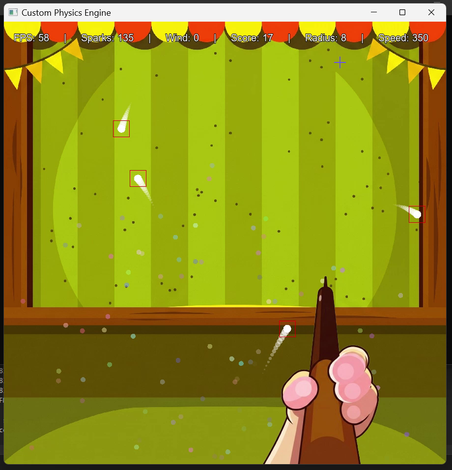

# Custom Physics Engine: Firework Shooter
 
A small 2D physics engine written from scratch in C++ with [SFML 3](https://www.sfml-dev.org/), plus a mini game built on top of it. Rockets launch into the air under gravity, and you shoot them mid-flight to set off firework bursts. Every particle, arc and bounce is driven by the engine's own vector math and integrator, not by a third-party physics library.
 
Built as part of the Mahara Tech physics engine course.
 

 
**Demo video (1 min):** [assets/demo.mp4](assets/demo.mp4)
 
## What the engine includes
 
| Area | Implementation |
| --- | --- |
| **Vector math** | Custom `Vec2` struct with `+`, `-`, scalar `*`, `+=`, `-=`, length, squared length, normalization, dot product, and 2D cross product |
| **Rigid bodies** | `RigidBody` with position, velocity, acceleration, mass / inverse mass, restitution, damping, and a force accumulator |
| **Rotation** | Angle, angular velocity, torque accumulation, moment of inertia (`RectInertia`), and `AddForceAtPoint` (torque = r x F) |
| **Integration** | Semi-implicit Euler: forces -> acceleration -> velocity -> position, with the accumulator cleared each step |
| **Time step** | Fixed 60 Hz step (`FIXED_DT`) driven by a frame-time accumulator, so physics stays stable at any frame rate |
| **Render interpolation** | Each body stores `prevPosition` so rendering can interpolate between physics steps |
| **Forces** | Gravity, linear drag (`F = -k v`), and a constant horizontal wind force |
| **Collision tests** | Circle vs circle, AABB vs AABB, circle vs AABB (using squared distances, no `sqrt`) |
| **Bounce response** | `BounceVelocity` using a coefficient of restitution; impulse helper for two-body response |
 
## The game
 
- Rockets auto-launch from the bottom center every 0.6 s toward random targets.
- The launch velocity is **solved from kinematics** so each rocket peaks at the target height: `vy = -sqrt(2 * g * dy)`, time to apex `t = -vy / g`, and `vx = dx / t`.
- **Click a rocket** (red hitbox) to shoot it: it bursts into 80 sparks with random direction, speed, mass and lifetime.
- Sparks are affected by gravity, drag, and wind, and fade out over their lifetime.
- Every hit adds to your score and triggers a short screen shake and a muzzle-flash animation.
- **Difficulty scales** every 15 points: rockets alternately get smaller (radius -2, min 5) and faster (speed +50, max 700).
- A HUD shows FPS, active sparks, wind, score, rocket radius, and rocket speed.
- The gun sprite follows the mouse horizontally.
### Controls
 
| Input | Action |
| --- | --- |
| Mouse | Aim the gun |
| Left click | Shoot |
| Left / Right arrow | Decrease / increase wind by 50 |
| Down arrow | Reset wind to 0 |
| Esc | Quit |
 
## Build and run
 
**Requirements:** a C++17 compiler and **SFML 3.x** (the code uses the SFML 3 API: `pollEvent` returning `std::optional`, `Keyboard::Scancode`, `VideoMode({w, h})`).
 
Place these files next to the executable (working directory):
 
- `Bg.jpeg` (background)
- `gun.png` (gun sprite)
- `gunfire.png` (gun sprite with muzzle flash)
Put the code in `Source.cpp`, then build with CMake:
 
```cmake
cmake_minimum_required(VERSION 3.16)
project(CustomPhysicsEngine CXX)
set(CMAKE_CXX_STANDARD 17)
 
find_package(SFML 3 COMPONENTS Graphics REQUIRED)
add_executable(game Source.cpp)
target_link_libraries(game PRIVATE SFML::Graphics)
```
 
```bash
cmake -B build
cmake --build build
```
 
Or add `Source.cpp` to a Visual Studio project linked against SFML 3.
 
> The HUD font is loaded from `C:/Windows/Fonts/arial.ttf`, so the project runs on Windows as is. On other systems, change that path in `main()`.
 
## Project structure
 
```
Source.cpp   # engine (Vec2, RigidBody, integrator, collision tests) + game logic
Bg.jpeg      # background
gun.png      # gun sprite
gunfire.png  # gun sprite while firing
assets/      # screenshot and demo video for this README
```
 
## Known limitations and next steps
 
- Rockets that are not shot keep falling and are never removed once off-screen; adding culling would keep the list from growing.
- The collision functions (circle/AABB tests) and ground-bounce code are written but not yet wired into the game loop; rocket hits currently use a simple point-in-rectangle check on each rocket's hitbox.
- Sparks are integrated before their forces are applied in the fixed-step loop; reordering to apply forces first, then integrate once, would be cleaner.
- Next steps: collision response between bodies, rotation in the game, and a spatial partition for broad-phase checks.
## What I learned
 
Building a physics loop from first principles: fixed time steps, force accumulation, integration order, kinematic launch solving, and keeping physics separate from rendering.
 
